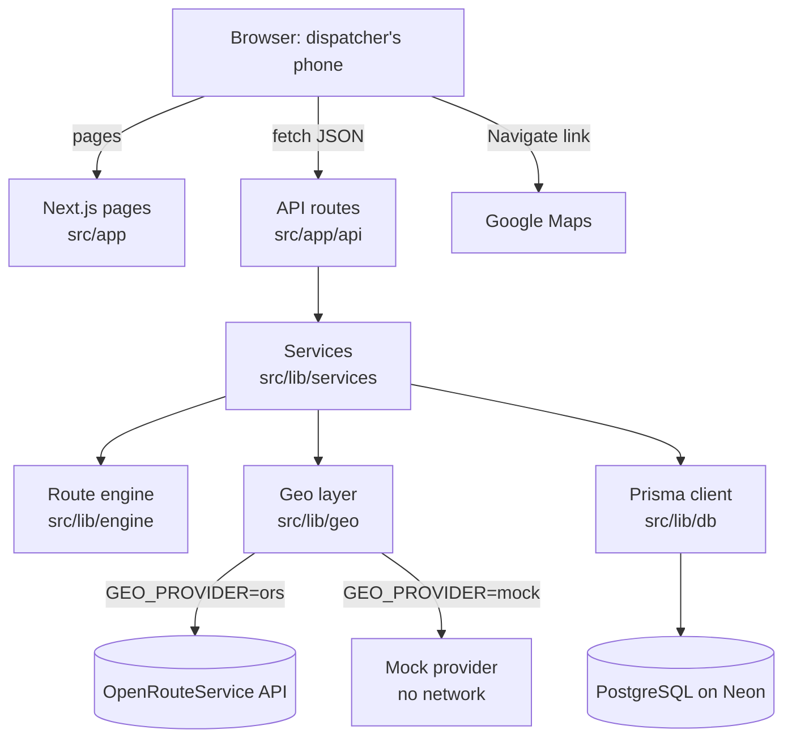
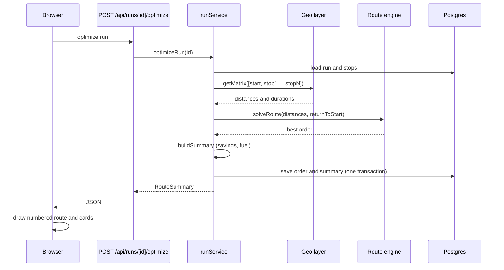
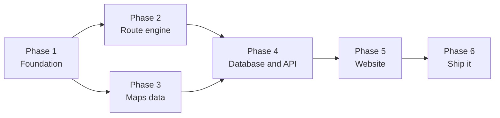
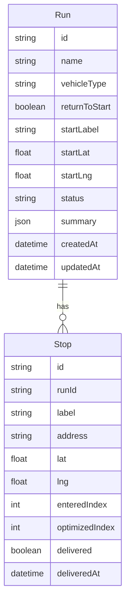

# Stopora Roadmap

> Find the best order for your delivery stops.

Stopora is a website for delivery riders and dispatchers in Lagos, Nigeria. A dispatcher enters a start point and up to 12 delivery stops. Stopora returns the order of travel with the shortest total road distance. It shows that order on a map as a numbered route and reports the distance, time and fuel saved compared with the order the dispatcher typed. The rider can open each leg in Google Maps and mark stops as delivered.

This roadmap is the single plan for building Stopora from an empty repo to a live website. It is built in six phases by six people. Each person builds one phase with their own AI coding agent, pushes to this repo, and the next person continues from there.

---

## Table of contents

1. [Goals and scope](#1-goals-and-scope)
2. [How it works for a user](#2-how-it-works-for-a-user)
3. [Architecture](#3-architecture)
4. [Tech stack](#4-tech-stack)
5. [Repository structure](#5-repository-structure)
6. [Shared contracts](#6-shared-contracts)
7. [How the team works](#7-how-the-team-works)
8. [Phase overview](#8-phase-overview)
9. [Phase 1: Foundation](#phase-1-foundation)
10. [Phase 2: Route engine](#phase-2-route-engine)
11. [Phase 3: Maps data](#phase-3-maps-data)
12. [Phase 4: Database and API](#phase-4-database-and-api)
13. [Phase 5: Dispatcher website](#phase-5-dispatcher-website)
14. [Phase 6: Integration, testing and deployment](#phase-6-integration-testing-and-deployment)
15. [Definition of done for every phase](#15-definition-of-done-for-every-phase)
16. [Risks and how we handle them](#16-risks-and-how-we-handle-them)
17. [Known limits](#17-known-limits)
18. [After the MVP](#18-after-the-mvp)
19. [Glossary](#19-glossary)

---

## 1. Goals and scope

### The problem

A dispatcher with six deliveries usually visits them in the order the orders came in, or in whatever order feels right. On Lagos roads that wastes fuel and time. Picking the best order by hand is hard, because the number of possible orders grows very fast. Six stops have 720 possible orders. Twelve stops have 479,001,600.

### The goal

Give a dispatcher the best visiting order in a few seconds, on their phone, and show them how much it saves.

### In scope for the MVP

- One dispatcher, one vehicle, one run at a time.
- One start point and up to 12 stops.
- Open routes (end at the last stop) and round trips (return to start).
- Address search and dropping pins on a map.
- Real road distances and times from OpenRouteService.
- Savings in km, minutes, litres and naira compared with the entered order.
- Google Maps handoff for turn-by-turn navigation.
- Marking stops as delivered.
- A live public website.

### Out of scope for the MVP

- User accounts and login.
- Several riders or vehicles sharing one set of stops.
- Delivery time windows (for example "deliver between 2pm and 4pm").
- Live traffic.
- Pickup and delivery pairs.
- Native mobile apps.

### Success measures

| Measure | Target |
| --- | --- |
| Optimization result for 3 to 13 points | Proven optimal (matches brute force in tests) |
| Engine time for 13 points | Under 200 ms |
| Average distance saved vs entered order | Measured and reported in `docs/RESULTS.md` |
| Lighthouse mobile scores (Performance, Accessibility, Best Practices) | 90 or above |
| CI on `main` | Always green |
| Live site | Works on a phone with real Lagos addresses |

---

## 2. How it works for a user

1. Open the site and tap **Plan a route**.
2. Name the run, choose a vehicle (motorbike, car or van), choose whether to return to start, and search for the start point.
3. Add stops by searching an address or dropping a pin on the map.
4. Tap **Optimize route**.
5. See numbered markers on the map, the stop list in the best order, and cards showing distance, time, fuel and savings.
6. Tap **Navigate** on a stop to open that leg in Google Maps.
7. Tick **Delivered** after each drop. When every stop is ticked, the run is complete.

---

## 3. Architecture



### What happens when the user taps Optimize



### Design rules

- **The engine knows nothing about maps.** It takes a table of numbers and returns an order. This keeps it easy to test and easy to explain.
- **The geo layer hides the provider.** The rest of the app never knows whether distances came from OpenRouteService or the mock.
- **API keys stay on the server.** The browser only talks to our own `/api` routes.
- **Business logic lives in services, not route handlers.** Route handlers only validate input and format output.
- **Point 0 is always the start.** Every matrix, every order and every summary follows this rule.

---

## 4. Tech stack

| Layer | Choice | Why |
| --- | --- | --- |
| Framework | Next.js 15 (App Router) | Website and API in one project, easy to deploy |
| Language | TypeScript, strict mode | Shared types catch mismatches between phases |
| Styling | Tailwind CSS | Fast, consistent, mobile first |
| Database | PostgreSQL on Neon | Free tier, works with Vercel |
| ORM | Prisma | Typed queries and simple migrations |
| Maps display | Leaflet with OpenStreetMap tiles | Free, no billing setup |
| Geocoding and distances | OpenRouteService | Free tier, real road distance matrix |
| Validation | zod | One place to check every request |
| Unit tests | Vitest | Fast, works with TypeScript |
| End-to-end tests | Playwright | Tests the real site in a browser |
| CI | GitHub Actions | Runs checks on every push and pull request |
| Hosting | Vercel | Turns the repo into a live website on every push |
| Package manager | npm | One tool for everyone |

### Environment variables

| Name | Used by | Notes |
| --- | --- | --- |
| `DATABASE_URL` | Phase 4 onward | Neon connection string. Never commit it. |
| `ORS_API_KEY` | Phase 3 onward | OpenRouteService key. Never commit it. |
| `GEO_PROVIDER` | Phase 3 onward | `ors` for real data, `mock` for tests and CI |
| `FUEL_PRICE_NGN_PER_LITRE` | Phase 5 onward | Optional. Shows naira saved when set. |
| `TEST_DATABASE_URL` | Phase 4 onward | Optional. Enables the database integration test. |

Secrets live in `.env.local` only. The repo keeps `.env.example` with empty values.

---

## 5. Repository structure

This is the shape of the repo after Phase 6. Phase 1 creates every folder.

```text
stopora/
├── .github/workflows/ci.yml        CI: lint, typecheck, test, build, e2e
├── docs/
│   ├── PROJECT_BRIEF.md            Phase 1: the brief every agent reads
│   ├── ALGORITHM.md                Phase 2: how the engine works
│   ├── engine-benchmark.md         Phase 2: savings on random Lagos stops
│   ├── API.md                      Phase 4: every endpoint
│   ├── screenshots/                Phase 5: planner before and after
│   ├── AUDIT.md                    Phase 6: problems found and fixed
│   ├── RESULTS.md                  Phase 6: savings on real roads
│   └── DEFENSE.md                  Phase 6: team defense guide
├── prisma/
│   ├── schema.prisma               Phase 4
│   ├── migrations/                 Phase 4
│   └── seed.ts                     Phase 4: "Lekki morning run"
├── scripts/
│   ├── benchmark-engine.ts         Phase 2
│   ├── try-geo.ts                  Phase 3
│   └── results.ts                  Phase 6
├── src/
│   ├── app/
│   │   ├── page.tsx                Phase 5: landing page
│   │   ├── plan/page.tsx           Phase 5: start a run
│   │   ├── runs/page.tsx           Phase 5: recent runs
│   │   ├── runs/[id]/page.tsx      Phase 5: planner screen
│   │   └── api/                    Phase 4: route handlers
│   ├── components/                 Phase 5: UI components
│   ├── lib/
│   │   ├── engine/                 Phase 2: route optimization
│   │   ├── geo/                    Phase 3: geocoding and matrix
│   │   ├── db/                     Phase 4: Prisma client
│   │   ├── services/               Phase 4: business logic
│   │   ├── apiClient.ts            Phase 5: typed fetch helpers
│   │   └── mapsLinks.ts            Phase 5: Google Maps links
│   └── types/index.ts              Phase 1: shared contracts
├── tests/
│   ├── unit/                       Vitest
│   └── e2e/                        Playwright
├── .env.example
├── HANDOFF.md                      Updated at the end of every phase
├── README.md
└── ROADMAP.md                      This file
```

---

## 6. Shared contracts

`src/types/index.ts` is the agreement between all six phases. Phase 1 writes it. **No phase may change it without the whole team agreeing.** If an AI agent wants to change a type, it must stop and explain why.

```ts
/** A point on the map. */
export type LatLng = { lat: number; lng: number };

/** One delivery stop. */
export type Stop = {
  id: string;
  label: string;
  address?: string;
  lat: number;
  lng: number;
  delivered: boolean;
};

/**
 * Travel costs between every pair of points.
 * distances in metres, durations in seconds.
 * Row i, column j is travel from point i to point j.
 * Point 0 is always the start.
 */
export type DistanceMatrix = { distances: number[][]; durations: number[][] };

/** Options for the route engine. */
export type SolveOptions = { returnToStart: boolean };

/** Engine output. order lists matrix indices and always begins with 0. */
export type SolveResult = {
  order: number[];
  cost: number;
  algorithm: "held-karp" | "nn-2opt" | "trivial";
};

/** Vehicle used for fuel estimates. */
export type VehicleType = "motorbike" | "car" | "van";

/** Everything the planner screen shows after optimizing. */
export type RouteSummary = {
  order: number[];
  totalDistanceM: number;
  totalDurationS: number;
  baselineDistanceM: number;
  baselineDurationS: number;
  distanceSavedPct: number;
  fuelLitres: number;
  baselineFuelLitres: number;
  algorithm: SolveResult["algorithm"];
};

/** One address search result. */
export type GeocodeResult = { label: string; lat: number; lng: number };
```

Other contracts every phase keeps:

- **Error shape for every API error:** `{ error: { code: string, message: string } }`
- **Stop limit:** 12 stops per run (13 points including the start).
- **Coordinates:** our code uses `{ lat, lng }`. OpenRouteService uses `[lng, lat]`. Only the geo layer converts.
- **`HANDOFF.md`:** every phase updates it before merging.

---

## 7. How the team works

### Before Phase 1 (team lead)

- [ ] Create an empty GitHub repo named `stopora` and add all six people as collaborators.
- [ ] Get a free OpenRouteService API key at openrouteservice.org. Share it privately.
- [ ] Create a free Postgres database on Neon (neon.tech). Share the connection string privately.
- [ ] Assign an owner to each phase in the [phase overview](#8-phase-overview).

### The loop every person follows

1. `git clone` the repo, or `git pull` on `main` if you already have it.
2. `git checkout -b phase-N` where N is your phase number.
3. Copy `.env.example` to `.env.local` and fill in the values your phase needs.
4. Open the folder in your AI coding tool (Antigravity, Cursor, Claude Code or any other). Paste your phase prompt from the Stopora Build Prompts document exactly as written.
5. Run `npm install`, `npm run lint`, `npm run typecheck`, `npm test` and `npm run build`. All must pass.
6. Read what the agent built. You will defend it.
7. Open a pull request to `main`. One other person reviews it. Merge it.
8. Tag it: `git tag phase-N-done` then `git push --tags`.
9. Post in the group chat that your phase is done.

### Why different AI agents still produce one website

An agent does not need to remember what another agent did. It reads the repo. Every prompt after Phase 1 tells the agent to read `docs/PROJECT_BRIEF.md`, `HANDOFF.md` and `src/types/index.ts` before writing code. The repo is the shared memory, the types are the shared language, and CI rejects anything that breaks earlier work.

### Branch and commit rules

- Branch names: `phase-1` to `phase-6`. Small fixes: `fix/short-description`.
- Never push directly to `main`.
- Commit messages start with the phase: `phase-2: add Held-Karp solver`.
- If you merge second and hit a conflict in `package.json` or `package-lock.json`, keep both sets of changes, then run `npm install` again.

---

## 8. Phase overview

| Phase | Name | Delivers | Depends on | Owner | Status |
| --- | --- | --- | --- | --- | --- |
| 1 | Foundation | Next.js app, project brief, shared types, CI | Nothing | | Not started |
| 2 | Route engine | Best stop order from a distance table | Phase 1 | | Not started |
| 3 | Maps data | Address search and real road distances | Phase 1 | | Not started |
| 4 | Database and API | Saved runs, stops and the optimize endpoint | Phases 2 and 3 | | Not started |
| 5 | Dispatcher website | Planner page with map, list and Google Maps handoff | Phase 4 | | Not started |
| 6 | Ship it | End-to-end tests, live deployment, results, defense guide | Phase 5 | | Not started |



Phases 2 and 3 only need Phase 1, so those two people work at the same time.

### What exists after each phase

| After phase | You can |
| --- | --- |
| 1 | Run `npm run dev` and see the Stopora placeholder home page |
| 2 | Run `npm run bench:engine` and see how much optimizing saves on random stops |
| 3 | Run `npm run try:geo` and see real Lagos addresses and road distances |
| 4 | Create a run, add stops and optimize it with `curl` |
| 5 | Use the full website on your laptop in a phone-sized window |
| 6 | Open the live link on any phone |

---

## Phase 1: Foundation

**Goal:** an empty but working website that every other phase builds on.

**Needs:** nothing.

### Tasks

- [ ] Scaffold Next.js 15 with TypeScript strict mode, Tailwind, ESLint, the `src/` directory, the App Router and the `@/` import alias.
- [ ] Create every folder in [Repository structure](#5-repository-structure) with a placeholder file.
- [ ] Write `src/types/index.ts` exactly as in [Shared contracts](#6-shared-contracts), with a JSDoc comment on each type.
- [ ] Add npm scripts: `dev`, `build`, `start`, `lint`, `test`, `test:watch`, `test:e2e`, `typecheck`.
- [ ] Set up Vitest with one test in `tests/unit/types.test.ts`.
- [ ] Set up Playwright (Chromium only) with a smoke test that checks the title contains Stopora.
- [ ] Create `.env.example` and make sure `.env.local` is ignored by git.
- [ ] Create `.github/workflows/ci.yml`: `npm ci`, lint, typecheck, test, build, with `GEO_PROVIDER=mock`.
- [ ] Replace the default home page with a placeholder: title, tagline, disabled "Plan a route" button.
- [ ] Save the project brief as `docs/PROJECT_BRIEF.md`.
- [ ] Write `README.md` and the first `HANDOFF.md`.

### Deliverables

`src/types/index.ts`, `docs/PROJECT_BRIEF.md`, `README.md`, `HANDOFF.md`, CI workflow, placeholder home page.

### Done when

- [ ] Lint, typecheck, tests and build pass.
- [ ] CI is green on the pull request.
- [ ] `npm run dev` shows the Stopora home page.

### What the owner must be able to explain

- Why the shared types file exists and why nobody may change it alone.
- What the App Router is and where pages and API routes live.
- What CI does on every push.

---

## Phase 2: Route engine

**Goal:** given a table of travel costs, return the best visiting order. This is the core of the project and of the defense.

**Needs:** Phase 1.

### How the engine decides

| Points (start + stops) | Algorithm | Result |
| --- | --- | --- |
| 1 or 2 | Trivial | Only one possible order |
| 3 to 13 | Held-Karp dynamic programming | Proven optimal |
| 14 to 51 | Nearest neighbour, then 2-opt | Very good, not guaranteed optimal |

The UI limits runs to 12 stops, so every real run gets the exact answer. The heuristic exists so the engine is safe if the limit is raised later.

### Tasks

- [ ] `src/lib/engine/cost.ts`: `routeCost(order, distances, returnToStart)`.
- [ ] `src/lib/engine/validate.ts`: reject empty, non-square, over 51 points, negative, NaN or Infinity.
- [ ] `src/lib/engine/heldKarp.ts`: bitmask dynamic programming with typed arrays and parent pointers. Supports open routes and round trips. Handles asymmetric matrices.
- [ ] `src/lib/engine/heuristic.ts`: nearest neighbour from point 0, then 2-opt that never moves point 0. Recomputes cost with `routeCost` because roads are not symmetric. Stops at 2,000 iterations.
- [ ] `src/lib/engine/index.ts`: `solveRoute(distances, options)` picks the algorithm and re-exports `routeCost`.
- [ ] Tests with a seeded random generator:
  - [ ] Held-Karp equals brute force on 200 random matrices of 3 to 8 points (symmetric, asymmetric, open, round trip).
  - [ ] Order always starts at 0 and contains every index once.
  - [ ] A hand-made 5-point case with a known answer.
  - [ ] Every validation error.
  - [ ] 13 points finish in under 200 ms.
  - [ ] Heuristic on 25 points is never worse than its nearest-neighbour start.
- [ ] `scripts/benchmark-engine.ts` (`npm run bench:engine`): 100 random sets of 8 Lagos stops, report average, best and worst saving. Save to `docs/engine-benchmark.md`.
- [ ] `docs/ALGORITHM.md`: the Travelling Salesman Problem, why brute force fails, Held-Karp step by step with a worked example, its cost, why we switch to the heuristic, how 2-opt works.
- [ ] Update `HANDOFF.md`.

### Deliverables

`src/lib/engine/`, `tests/unit/engine/`, `docs/ALGORITHM.md`, `docs/engine-benchmark.md`.

### Done when

- [ ] All tests pass, including the brute-force comparison and timing test.
- [ ] Benchmark output is saved.

### What the owner must be able to explain

- Why 12 stops have 479,001,600 possible orders.
- How Held-Karp reuses smaller answers, and why its cost is about n² × 2ⁿ instead of n!.
- What a 2-opt move is and why it removes crossing paths.
- Why road distance from A to B can differ from B to A.

---

## Phase 3: Maps data

**Goal:** turn typed addresses into coordinates and get real road distances between every pair of points.

**Needs:** Phase 1, the OpenRouteService key. Runs at the same time as Phase 2.

### Tasks

- [ ] `src/lib/geo/provider.ts`: the `GeoProvider` interface with `geocode` and `getMatrix`.
- [ ] `src/lib/geo/orsProvider.ts`:
  - [ ] Geocode with `boundary.country=NG`, focused on central Lagos (6.5244, 3.3792), 5 results.
  - [ ] Matrix with `POST /v2/matrix/driving-car`, distance and duration in metres and seconds.
  - [ ] Convert `{ lat, lng }` to `[lng, lat]` and prove it with a test.
  - [ ] Clear errors for unreachable stops, 401, 403, 429, 5xx and a 10 second timeout.
  - [ ] Read the key at call time, not import time.
- [ ] `src/lib/geo/mockProvider.ts`: 15 real Lagos places, haversine × 1.3 for road distance, 20 km/h for duration.
- [ ] `src/lib/geo/index.ts`: choose provider by `GEO_PROVIDER`, with a 10 minute in-memory cache.
- [ ] `src/lib/geo/haversine.ts`: straight-line distance in metres.
- [ ] Tests (no real API calls): haversine sanity check, mock matrix shape, ORS request and response mapping with mocked fetch, error messages, cache hits.
- [ ] `scripts/try-geo.ts` (`npm run try:geo`): geocode three real addresses and print their distance matrix.
- [ ] Update `HANDOFF.md`.

### Deliverables

`src/lib/geo/`, `tests/unit/geo/`, `scripts/try-geo.ts`.

### Done when

- [ ] Lint, typecheck, tests and build pass with `GEO_PROVIDER=mock`.
- [ ] `npm run try:geo` works with `GEO_PROVIDER=ors`.

### What the owner must be able to explain

- What geocoding is and what a distance matrix is.
- Why we have a mock provider and when each provider is used.
- Why the API key must never reach the browser.
- Why the cache matters for a free API quota.

---

## Phase 4: Database and API

**Goal:** connect the engine and the maps layer behind a clean API, and save runs.

**Needs:** Phases 2 and 3 tagged done, the Neon connection string.

### Data model



Run status moves `draft` → `optimized` → `completed`. Adding or removing a stop sends it back to `draft`.

### API endpoints

| Method | Path | Body | Returns |
| --- | --- | --- | --- |
| POST | `/api/runs` | `{ name, vehicleType, returnToStart, start: { label, lat, lng } }` | Run |
| GET | `/api/runs` | | Latest 20 runs |
| GET | `/api/runs/[id]` | | Run with stops |
| POST | `/api/runs/[id]/stops` | `{ label, address?, lat, lng }` | Stop |
| DELETE | `/api/runs/[id]/stops/[stopId]` | | Updated run |
| PATCH | `/api/runs/[id]/stops/[stopId]` | `{ delivered: boolean }` | Stop |
| POST | `/api/runs/[id]/optimize` | | `RouteSummary` |
| GET | `/api/geocode?q=...` | | `GeocodeResult[]` |

All bodies and params are validated with zod. Coordinates outside Nigeria (lat 4 to 14, lng 2.5 to 15) get a 422.

### Fuel assumptions

| Vehicle | Litres per km |
| --- | --- |
| Motorbike | 0.03 |
| Car | 0.09 |
| Van | 0.12 |

These are estimates. The team should be ready to defend or adjust them.

### Tasks

- [ ] Prisma schema, first migration, scripts `db:migrate`, `db:studio`, `db:seed`, and `postinstall` running `prisma generate`.
- [ ] `src/lib/db/index.ts`: one reused Prisma client.
- [ ] `src/lib/services/fuel.ts`.
- [ ] `src/lib/services/routeSummary.ts`: `buildSummary` as a pure function. Baseline is the entered order.
- [ ] `src/lib/services/runService.ts`: `createRun`, `listRuns`, `getRun`, `addStop` (blocks a 13th stop), `removeStop`, `setDelivered`, `optimizeRun` (one transaction).
- [ ] Route handlers for every endpoint above with one error shape.
- [ ] `prisma/seed.ts`: "Lekki morning run" with 8 real stops in a deliberately poor order.
- [ ] Tests: fuel, `buildSummary` (including 0% saved), zod schemas, and a full-flow integration test that skips when `TEST_DATABASE_URL` is not set.
- [ ] `docs/API.md` with request, response and errors for each endpoint.
- [ ] Update `HANDOFF.md` with curl examples and notes for Phase 5.

### Deliverables

`prisma/`, `src/lib/db/`, `src/lib/services/`, `src/app/api/`, `docs/API.md`.

### Done when

- [ ] Migrations run on Neon and the seed works.
- [ ] Lint, typecheck, tests and build pass.
- [ ] The curl flow create, add stops, optimize, get works.

### What the owner must be able to explain

- How a request travels from route handler to service to engine and back.
- Why optimizing saves in one transaction.
- How the baseline and the savings percentage are calculated.
- Why the geocode endpoint exists on our server.

---

## Phase 5: Dispatcher website

**Goal:** every page a dispatcher touches, built mobile first.

**Needs:** Phase 4. The browser only calls our `/api` routes.

### Pages

| Route | Purpose |
| --- | --- |
| `/` | Landing page: headline, explanation, 3-step "how it works", Plan a route button, link to recent runs |
| `/plan` | Start a run: name, vehicle toggle, return-to-start switch, start point search |
| `/runs` | Recent runs with stops, status and distance saved |
| `/runs/[id]` | The planner screen |

### Planner screen

```text
┌──────────────────────────────┐
│            MAP               │  start marker S, stop markers,
│   S ─ 1 ─ 2 ─ 3 ─ 4 ─ 5      │  numbered after optimizing
├──────────────────────────────┤
│ [ Search an address ] [Pin]  │  5 of 12 stops
├──────────────────────────────┤
│ [      Optimize route      ] │
├──────────────────────────────┤
│ 18.4 km │ 1h 05m │ 0.6 L     │  summary cards
│ Saved 27% (6.8 km) ₦850      │
├──────────────────────────────┤
│ 1 Yaba        [Navigate] [✓] │  ordered stop list
│ 2 Surulere    [Navigate] [ ] │
│ ...                          │
│ [ Open full route in Maps ]  │
└──────────────────────────────┘
```

### Tasks

- [ ] Leaflet and react-leaflet loaded with `next/dynamic` and `ssr: false`, OpenStreetMap attribution, fixed marker icons, default view on central Lagos.
- [ ] `AddressSearch`: 400 ms debounce, 3 character minimum, 5 results, loading, empty and error states, keyboard support.
- [ ] Planner: add by search or dropped pin, 12 stop counter and limit, remove stops, Optimize button (disabled under 2 stops) with loading state.
- [ ] After optimizing: numbered markers, polyline in visit order, map fits the route, caption saying the line shows order not road path.
- [ ] Summary cards: distance, time, fuel, saved percent and km, naira saved when `FUEL_PRICE_NGN_PER_LITRE` is set (read on the server).
- [ ] Ordered list with per-leg Navigate links and a Delivered checkbox.
- [ ] Full route link with waypoints, split into Part 1 and Part 2 past 9 waypoints.
- [ ] Run completed banner. Clear the optimized view when stops change.
- [ ] `src/lib/apiClient.ts` with one typed function per endpoint. Errors shown as dismissible toasts.
- [ ] `src/lib/mapsLinks.ts` for Google Maps links.
- [ ] Tests with Testing Library: `AddressSearch`, summary formatting, link builder including the split.
- [ ] Accessibility: labels on every control, visible focus, colour never the only signal, Lighthouse accessibility 90 or above.
- [ ] Dark mode, 44 px minimum tap targets, high contrast.
- [ ] Screenshots before and after optimizing in `docs/screenshots/`.
- [ ] Update `HANDOFF.md`.

### Deliverables

`src/app/` pages, `src/components/`, `src/lib/apiClient.ts`, `src/lib/mapsLinks.ts`, screenshots.

### Done when

- [ ] On a phone-sized window with the seeded run: add a stop, optimize, see numbers and savings, open a leg in Google Maps, tick a delivery.
- [ ] Lint, typecheck, tests and build pass.

### What the owner must be able to explain

- Why the map is loaded only in the browser.
- How the page talks to the API and handles errors.
- Why the Google Maps link is split past 9 waypoints.
- The accessibility choices made for riders on the move.

---

## Phase 6: Integration, testing and deployment

**Goal:** prove the whole thing works, put it online, and prepare the team to defend it.

**Needs:** Phase 5, a Vercel account linked to the repo.

### Tasks

- [ ] **Audit:** walk the full flow with `mock` and then `ors`. Log every problem in `docs/AUDIT.md` before fixing. Fix and tick each one.
- [ ] **Edge cases** give clear messages, not crashes:
  - [ ] 0 or 1 stop
  - [ ] Exactly 12 stops
  - [ ] Two stops at the same address
  - [ ] A stop the road network cannot reach
  - [ ] ORS key missing or rate limited
  - [ ] Database unreachable
  - [ ] Run id that does not exist
  - [ ] Very slow network
- [ ] **End-to-end tests** with Playwright and `GEO_PROVIDER=mock`:
  - [ ] Happy path: create, add 6 stops, optimize, check markers and cards, deliver all, see completed banner.
  - [ ] Validation: optimize disabled under 2 stops, 13th stop blocked.
  - [ ] Mobile: happy path at 360 × 740.
  - [ ] CI job with a Postgres service container.
- [ ] **Performance:** Lighthouse 90 or above on mobile for Performance, Accessibility and Best Practices. Leaflet only loads on map pages.
- [ ] **Security:** confirm secrets are not in the browser bundle. Rate limit `/api/geocode` and `/api/runs/[id]/optimize` (30 per minute per IP) with a 429. Add security headers.
- [ ] **Deploy to Vercel:** set environment variables, run `prisma migrate deploy` in the build, seed production, put the live URL at the top of `README.md`.
- [ ] **Results:** `scripts/results.ts` (`npm run results`) runs 20 realistic Lagos runs of 6 to 10 stops on real roads and writes `docs/RESULTS.md` with averages.
- [ ] **Defense guide:** `docs/DEFENSE.md` with the problem, an architecture diagram, one section per phase (owner, purpose, key files, three hard questions with answers), the results, and known limits.
- [ ] **Clean-up:** remove dead code and console logs, README setup in under 10 steps, every phase marked done, `HANDOFF.md` marked complete with the live URL.

### Deliverables

Live URL, `docs/AUDIT.md`, `docs/RESULTS.md`, `docs/DEFENSE.md`, end-to-end tests and CI job.

### Done when

- [ ] CI is green including the end-to-end job.
- [ ] The live URL works on a phone with real Lagos addresses.
- [ ] `docs/RESULTS.md` has real numbers.
- [ ] `docs/DEFENSE.md` is complete.

### What the owner must be able to explain

- How a push to `main` becomes a live site.
- What the end-to-end tests cover and why the mock provider is used there.
- How the results were measured and what they mean.

---

## 15. Definition of done for every phase

A phase is done only when all of these are true:

- [ ] `npm run lint` passes.
- [ ] `npm run typecheck` passes.
- [ ] `npm test` passes.
- [ ] `npm run build` passes.
- [ ] CI is green on the pull request.
- [ ] `src/types/index.ts` is unchanged, or the team agreed to the change.
- [ ] `HANDOFF.md` is updated for the next person.
- [ ] One other team member reviewed and approved the pull request.
- [ ] The owner has read the code and can explain it without the AI agent.
- [ ] The phase is merged to `main` and tagged `phase-N-done`.

---

## 16. Risks and how we handle them

| Risk | Effect | How we handle it |
| --- | --- | --- |
| Someone starts on old code | Their work misses earlier phases | Always `git pull` on `main`. Start only after the previous tag exists. |
| An agent changes shared types | Earlier code stops fitting | Prompts forbid it. Typecheck and CI fail. Reviewer checks the file. |
| An agent breaks earlier work | Features stop working | Earlier tests run in CI on every pull request. |
| Merge conflict in Phases 2 and 3 | `package.json` conflict | Keep both changes, run `npm install`, commit. |
| OpenRouteService quota or outage | Optimize fails | In-memory cache, clear error message, mock provider for demos. |
| `lat`/`lng` order mixed up | Stops placed in the wrong country | Single conversion point in the geo layer, covered by a test. |
| Vague Lagos addresses | Wrong coordinates | Drop-a-pin option on the map. |
| A member cannot explain their phase | Weak defense | Owner reads their code before merging. Reviewer asks questions. Team studies `DEFENSE.md` and `ALGORITHM.md` together. |
| Secrets committed to git | Key leak | `.env.local` is ignored. Reviewer checks. Rotate the key if it leaks. |
| One phase runs late | Everyone after it waits | Post blockers in the group chat early. Phases 2 and 3 run in parallel to save time. |

---

## 17. Known limits

State these honestly in the defense.

- **No live traffic.** Times are typical road times, not current conditions.
- **No delivery time windows.** Every stop is treated as open all day.
- **One rider per run.** Splitting stops across several riders is a different, harder problem.
- **The map line shows visit order, not the road path.** Google Maps handles turn-by-turn directions.
- **Fuel figures are estimates.** They use fixed litres per km by vehicle.
- **12 stop limit.** It keeps every answer provably optimal and fast.

---

## 18. After the MVP

Ideas for later, in rough order of value:

1. Draw the real road path on the map with the OpenRouteService directions API.
2. Delivery time windows.
3. Multiple riders sharing one set of stops.
4. Import stops from a CSV or a WhatsApp order list.
5. Share a run with a rider by link.
6. Accounts for dispatch businesses with history and reports.
7. Offline mode for areas with weak signal.
8. A small Android wrapper for riders.

---

## 19. Glossary

| Term | Meaning |
| --- | --- |
| Run | One dispatcher's trip: a start point plus up to 12 stops |
| Stop | One delivery location |
| Distance matrix | A table of travel distance and time between every pair of points |
| Geocoding | Turning an address into map coordinates |
| Travelling Salesman Problem (TSP) | Finding the shortest route that visits every point once |
| Held-Karp | An exact TSP algorithm using dynamic programming |
| 2-opt | A heuristic that improves a route by reversing a section to remove crossings |
| Baseline | The route in the order the dispatcher entered the stops |
| Open route | A route that ends at the last stop |
| Round trip | A route that returns to the start |
| Mock provider | Fake maps data used in tests and CI so no API key is needed |
| CI | Continuous integration: automatic checks on every push |
| Handoff | The notes in `HANDOFF.md` that let the next person continue |